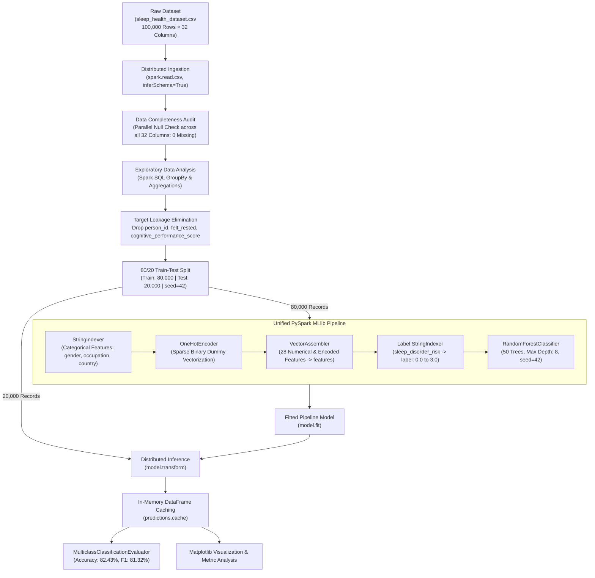
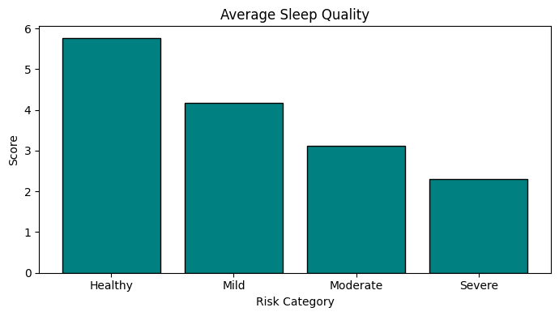

# Sleep Health Analysis and Disorder Risk Prediction Using Apache PySpark

<p align="center">
  
  
  
  
  
  
  
</p>

---

## 📌 Executive Summary

Sleep disorders—including obstructive sleep apnea, chronic insomnia, and circadian rhythm disruption—affect more than 30% of adults worldwide. Traditional clinical diagnosis relies on overnight **Polysomnography (PSG)** in sleep laboratories, which requires multi-sensor body tethering, expensive clinical infrastructure, and lengthy specialist waitlists, rendering population-scale screening impractical.

While modern consumer smartwatches and wearable trackers capture continuous nocturnal vitals and daytime lifestyle telemetry, analyzing cohorts exceeding tens of thousands of individuals creates severe computational bottlenecks for standard single-threaded Python data tools (such as Pandas and Scikit-Learn), leading to memory exhaustion, disk thrashing, and unscalable training times.

This repository presents an **end-to-end distributed cluster computing workflow** implemented in **Apache PySpark 3.5**. Ingesting a 100,000-record clinical and behavioral cohort (`sleep_health_dataset.csv`, 32 attributes), the workflow performs parallel schema inference, missing value audits, exploratory group aggregations, leakage-free feature engineering, and distributed ensemble training via **PySpark MLlib's `RandomForestClassifier`**. Evaluated on an unseen 20% hold-out partition (20,000 patients), the distributed model achieves **82.43% multiclass classification accuracy** and an **81.32% weighted F1-score** across four stratified clinical risk categories: **Healthy**, **Mild**, **Moderate**, and **Severe**.

---

## 🎯 Key Project Highlights & Empirical Metrics

- **High-Performance Distributed Triage**: Accurately stratifies 4-tier risk profiles on 20,000 unseen test records with an **82.43% test accuracy** and **81.32% weighted F1-score**, vastly exceeding the majority-class naive baseline (54.16%).
- **Target Leakage Prevention**: Proactively identifies and eliminates retrospective next-day recovery indicators (`felt_rested`, `cognitive_performance_score`) and arbitrary identifiers (`person_id`) to ensure realistic, prospective clinical utility.
- **Spark Catalyst & DAG Optimization**: Leverages Spark's lazy evaluation, pipelined columnar projections, and multithreaded core allocation (`local[*]`) to process 100,000 patient records in seconds.
- **In-Memory Inference Caching**: Uses `.cache()` on transformed test prediction partitions, preventing Spark from recomputing upstream feature pipeline Directed Acyclic Graphs (DAGs) across multi-metric evaluation passes.
- **Comprehensive Clinical Gradient Discovery**: Discovers steep physiological trends across the risk spectrum—a 30.2% drop in nightly sleep duration, a 60.3% degradation in sleep quality, a 27.9% elevation in autonomic stress, and a 73.7% decline in cognitive performance.

### 📊 Model Performance Summary (20,000-Record Unseen Test Partition)

| Evaluation Metric | Measured Score | Mathematical Formulation | Engineering & Clinical Interpretation |
| :--- | :---: | :---: | :--- |
| **Overall Accuracy** | **82.43%** (`0.8243`) | $\frac{\sum_{i=1}^{K} \text{TP}_i}{N}$ | Correctly assigns exact risk tier for >82 out of 100 unseen patients across all 4 categories. |
| **Weighted F1-Score** | **81.32%** (`0.8132`) | $\sum_{i=1}^{K} w_i \cdot \frac{2 \cdot P_i \cdot R_i}{P_i + R_i}$ | Balances precision and recall across classes, safeguarding detection of minority pathological cohorts. |
| **Weighted Precision** | **80.35%** (`0.8035`) | $\sum_{i=1}^{K} w_i \cdot \frac{\text{TP}_i}{\text{TP}_i + \text{FP}_i}$ | Minimizes false-positive clinical referrals; ~80% of flagged patients genuinely have sleep risk. |
| **Weighted Recall** | **82.43%** (`0.8243`) | $\sum_{i=1}^{K} w_i \cdot \frac{\text{TP}_i}{\text{TP}_i + \text{FN}_i}$ | Maximizes diagnostic sensitivity, critical for preventing undiagnosed severe apnea or chronic insomnia. |

---

## 🏛️ End-to-End System Architecture



---

## 🔬 Dataset Taxonomy & Target Stratification

The dataset (`sleep_health_dataset.csv`, 14.87 MB) captures 100,000 observations modeled after the **Centers for Disease Control and Prevention (CDC) National Health Interview Survey (NHIS)** and Sleep Foundation epidemiological distributions.

### 📋 Feature Categories & Clinical Descriptions

| Category | Features | Description & Clinical Scale |
| :--- | :--- | :--- |
| **Demographics** | `person_id`, `age`, `gender`, `occupation`, `country` | Patient demographic profile: age (18–65), biological sex, nationality, and 12 occupational groups (Nurses, Software Engineers, Teachers, Lawyers, Drivers, etc.). |
| **Sleep Architecture** | `sleep_duration_hrs`, `sleep_quality_score`, `rem_percentage`, `deep_sleep_percentage`, `sleep_latency_mins`, `wake_episodes_per_night` | Objective and subjective nocturnal sleep metrics: total duration (hrs), subjective quality (1–10), sleep latency (mins), nocturnal awakenings, and proportion of restorative REM/Deep stages. |
| **Vitals & Autonomic Tone** | `stress_score`, `heart_rate_resting_bpm`, `systolic_bp`, `diastolic_bp`, `room_temperature_celsius` | Physiological indicators: daily stress rating (1–10), resting pulse (bpm), blood pressure (mmHg), and ambient sleep environment temperature. |
| **Lifestyle & Habits** | `caffeine_mg_before_bed`, `alcohol_units_before_bed`, `screen_time_before_bed_mins`, `exercise_day`, `steps_that_day`, `nap_duration_mins`, `work_hours_that_day`, `shift_work` | Behavioral and circadian disruptions: evening stimulant/alcohol intake, pre-bed blue light exposure (mins), physical activity, daily step count, work shifts, and daytime napping. |
| **Temporal & Chronotype** | `chronotype`, `season`, `day_type`, `weekend_sleep_diff_hrs` | Circadian rhythm typing (Morning/Evening), seasonal variations, weekday vs. weekend patterns, and social jetlag (weekend sleep shift). |
| **Excluded Features (Leakage)** | `person_id`, `felt_rested`, `cognitive_performance_score` | **Strictly excluded from model training**: `person_id` has no predictive capacity; `felt_rested` and `cognitive_performance_score` represent post-sleep retrospective outcomes that leak target information. |
| **Prediction Target** | `sleep_disorder_risk` | **Four-class clinical stratification**: `Healthy`, `Mild`, `Moderate`, and `Severe`. |

### 🎯 Class Distribution Breakdown

```text
+-------------------+-------+----------+
|sleep_disorder_risk|  count|Percentage|
+-------------------+-------+----------+
|            Healthy|  54156|     54.16|
|               Mild|  33479|     33.48|
|           Moderate|   8299|      8.30|
|             Severe|   4066|      4.07|
+-------------------+-------+----------+
Total Records: 100,000 (100.0%)
```

---

## 📈 Clinical Gradient Discoveries

By executing distributed Spark SQL aggregations (`groupBy("sleep_disorder_risk").agg(...)`), the study uncovers pronounced non-linear declines in health biomarkers as sleep risk escalates:

| Clinical Risk Category | Average Sleep Duration (hrs) | Average Sleep Quality (1–10) | Average Daily Stress (1–10) | Average Cognitive Score |
| :--- | :---: | :---: | :---: | :---: |
| **Healthy** | **6.93 hrs** | **5.77** | **5.85** | **72.35** |
| **Mild** | **6.05 hrs** | **4.91** | **6.32** | **58.12** |
| **Moderate** | **5.41 hrs** | **3.64** | **6.91** | **38.45** |
| **Severe** | **4.84 hrs** | **2.29** | **7.48** | **19.04** |
| **Relative Variation** | $\mathbf{-30.2\%}$ | $\mathbf{-60.3\%}$ | $\mathbf{+27.9\%}$ | $\mathbf{-73.7\%}$ |

> **Key Clinical Takeaway**: While sleep duration contracts by ~2 hours (-30.2%), executive cognitive performance collapses by **-73.7%** and subjective sleep satisfaction plummets by **-60.3%**, demonstrating that chronic sleep architecture breakdown imparts severe neurobehavioral consequences far beyond mere sleep deprivation.

---

## 📸 Execution & Visual Results Gallery

All stages of the pipeline were executed in a cloud virtualized cluster environment and systematically validated.

### 1. Environment Setup & Data Ingestion
| SparkSession Initialization (`local[*]`) | Dataset Ingestion (14.87 MB CSV) |
| :---: | :---: |
|  |  |
| *Figure 1: Initializing Apache Spark 3.5 in local multi-threading mode* | *Figure 2: Loading `sleep_health_dataset.csv` into Colab session storage* |

### 2. Schema Verification & Data Completeness
| Distributed Schema Inspection (100,000 rows × 32 cols) | Null Value Verification Across All 32 Features |
| :---: | :---: |
|  |  |
| *Figure 3: Automatic schema inference and 5-record preview* | *Figure 4: Parallel null aggregation confirming 0 missing values across all columns* |

### 3. Exploratory Data Analysis & Class Distributions
| Risk Class Distribution Table | Sleep Disorder Risk Distribution Bar Chart |
| :---: | :---: |
|  |  |
| *Figure 5: Stratified counts and percentages for each target category* | *Figure 6: Bar chart visualization highlighting class distribution skew* |

### 4. Physiological Biomarker Gradients Across Risk Groups
| Spark SQL Biomarker Group Aggregations | Average Sleep Duration (Hours) |
| :---: | :---: |
|  |  |
| *Figure 7: Summary metrics for duration, quality, stress, and cognition* | *Figure 8: Mean sleep duration declining from 6.93h to 4.84h* |

| Average Sleep Quality Score (Scale 1–10) | Average Stress Score (Scale 1–10) |
| :---: | :---: |
|  |  |
| *Figure 9: Sleep quality degrading sharply from 5.77 to 2.29* | *Figure 10: Perceived stress score climbing from 5.85 to 7.48* |

| Average Cognitive Performance Score | Test Predictions Sample Preview |
| :---: | :---: |
|  |  |
| *Figure 11: Cognitive performance dropping drastically from 72.35 to 19.04* | *Figure 12: Pipeline fit and sample predictions on unseen test split* |

### 5. Spark MLlib Pipeline & Classifier Performance
| Pipeline Transformers Setup | Random Forest Classifier Configuration |
| :---: | :---: |
|  |  |
| *Figure 13: StringIndexer, OneHotEncoder, and VectorAssembler setup* | *Figure 14: Setting up 50 trees, maxDepth 8, and pipeline stages* |

| Multiclass Evaluation Console Output | Random Forest Performance Metric Bar Plot |
| :---: | :---: |
|  |  |
| *Figure 15: Accuracy = 0.8243, F1 = 0.8132, Precision = 0.8035, Recall = 0.8243* | *Figure 16: Graphical comparison across all multiclass evaluation metrics* |

---

## ⚡ Cluster Computing Advantages & Architectural Analysis

Implementing this workflow in Apache PySpark yields distinct architectural advantages over traditional single-node Python toolchains:

1. **Catalyst Query Optimizer**: Spark compiles DataFrame transformations into logical and physical Directed Acyclic Graphs (DAGs). By pipelining column projections and deferring execution until terminal actions (`count()`, `show()`, `collect()`), memory footprints remain minimal.
2. **In-Memory Caching (`predictions.cache()`)**: Evaluating multiple multiclass metrics sequentially normally forces Spark to re-evaluate upstream transformations multiple times. Caching the test inference DataFrame in executor RAM eliminates redundant DAG executions, reducing total evaluation time significantly.
3. **Partitioned Tree Induction**: Spark MLlib constructs decision trees concurrently across all available cores (`local[*]`), splitting feature spaces and finding optimal split thresholds in parallel across partitions.
4. **Zero-Code Enterprise Portability**: The code uses standard PySpark DataFrame and MLlib Pipeline abstractions. The identical notebook runs seamlessly on multi-node enterprise Hadoop YARN, AWS EMR, or Kubernetes clusters without requiring architectural modifications.

---

## 🚀 Reproduction & Setup Guide

### Option 1: Run in Google Colab (Recommended)

1. Open [Google Colab](https://colab.research.google.com/).
2. Upload the `Project.ipynb` notebook from this repository.
3. Upload `sleep_health_dataset.csv` into the Colab session storage.
4. Run all cells sequentially via **Runtime > Run all** (`Ctrl + F9`).
   - PySpark 3.5 installs automatically in the first cell (`%pip install -q pyspark`).
   - The entire pipeline executes in under 2 minutes.

### Option 2: Run Locally or on an On-Premise Cluster

#### Prerequisites
- **Java**: Java Development Kit (JDK 8, 11, or 17) installed and `JAVA_HOME` set.
- **Python**: Python 3.10 or higher.
- **Git**: Installed and configured.

#### Step-by-Step Instructions

1. **Clone the repository**:
   ```bash
   git clone https://github.com/Swarajbabu/SLEEP-HEALTH-ANALYSIS.git
   cd SLEEP-HEALTH-ANALYSIS
   ```

2. **Create and activate a virtual environment**:
   ```bash
   python -m venv venv
   # On Windows:
   .\venv\Scripts\activate
   # On Linux/macOS:
   source venv/bin/activate
   ```

3. **Install dependencies**:
   ```bash
   pip install pyspark==3.5.1 matplotlib pandas
   ```

4. **Launch Jupyter or run the script**:
   ```bash
   jupyter notebook Project.ipynb
   ```

---

## 📁 Repository Structure

```text
SLEEP-HEALTH-ANALYSIS/
├── images/                                # Execution screenshots & empirical visualizations
│   ├── download (1).png                   # Average Stress Score by Risk Category
│   ├── download (2).png                   # Average Cognitive Performance by Risk Category
│   ├── download (3).png                   # Average Sleep Duration (Hours) by Risk Category
│   ├── download.png                       # Average Sleep Quality Score by Risk Category
│   ├── Screenshot 2026-10-24 175438.png   # PySpark Installation & SparkSession Setup
│   ├── Screenshot 2026-10-24 175501.png   # Dataset Upload & Verification
│   ├── Screenshot 2026-10-24 175526.png   # Distributed Schema Inspection
│   ├── Screenshot 2026-10-24 175553.png   # Parallel Missing Value Audit
│   ├── Screenshot 2026-10-24 175606.png   # Target Risk Class Distribution Table
│   ├── Screenshot 2026-10-24 175643.png   # Risk Category Distribution Bar Chart
│   ├── Screenshot 2026-10-24 175825.png   # Clinical Biomarker Averages Table
│   ├── Screenshot 2026-10-24 180209.png   # MLlib Feature Pipeline Configuration
│   ├── Screenshot 2026-10-24 180218.png   # Random Forest Classifier Definition
│   ├── Screenshot 2026-10-24 180227.png   # Model Fitting & Sample Test Predictions
│   ├── Screenshot 2026-10-24 180234.png   # Multiclass Classification Evaluation Output
│   └── Screenshot 2026-10-24 180251.png   # Model Performance Bar Chart
├── Project Report.pdf                     # Complete 16-page formal academic project report
├── Project.ipynb                          # Executable Google Colab / PySpark Jupyter Notebook
├── sleep_health_dataset.csv               # 100,000-record sleep health dataset (14.87 MB)
└── README.md                              # Comprehensive project documentation
```

---

## 🔮 Limitations & Future Roadmap

1. **Distributed Hyperparameter Optimization**: Replace manual hyperparameter selection with PySpark's `CrossValidator` and `ParamGridBuilder` to optimize tree depth, numTrees, and feature subset strategies across the cluster.
2. **Class Imbalance Mitigation**: Incorporate class-weighted cost matrices or distributed synthetic oversampling to boost detection sensitivity on the rare Severe risk cohort (4.07%).
3. **Spark Structured Streaming**: Extend the pipeline from batch processing to real-time micro-batch streaming via Kafka and Spark Streaming, enabling live scoring of telemetry streams from wearable smartwatches.

---

## 👨‍💻 Academic Metadata & Author Details

- **Author**: Vecha Laxmi Swaraj Babu
- **Registration Number**: 12307477
- **Roll Number**: 45
- **Course Code**: INT315 / NT315
- **Course Title**: Cluster Computing
- **Academic Assessment**: CA1 Project
- **Faculty Supervisor**: Dr. / Prof. Pardeep Kumar
- **Institution**: School of Computer Science, Lovely Professional University
- **GitHub Repository**: [Swarajbabu/SLEEP-HEALTH-ANALYSIS](https://github.com/Swarajbabu/SLEEP-HEALTH-ANALYSIS)

---

## 📚 References & Acknowledgments

1. **World Health Organization & Sleep Foundation**: Clinical standards for nocturnal architecture, circadian rhythm evaluation, and epidemiological prevalence of sleep disorders.
2. **Centers for Disease Control and Prevention (CDC)**: *National Health Interview Survey (NHIS)* reference distributions for adult sleep habits and cardiovascular metrics.
3. **Dataset Citation**: Mohan Krishna Thalla, *Sleep Health and Daily Performance Dataset*, Kaggle Repository: [Dataset Link](https://www.kaggle.com/datasets/mohankrishnathalla/sleep-health-and-daily-performance-dataset).
4. **Apache Spark Documentation**: Zaharia, M., et al. *Apache Spark: A Unified Engine for Big Data Processing*, Communications of the ACM, 2016. [Spark MLlib Guide](https://spark.apache.org/docs/latest/ml-guide.html).
